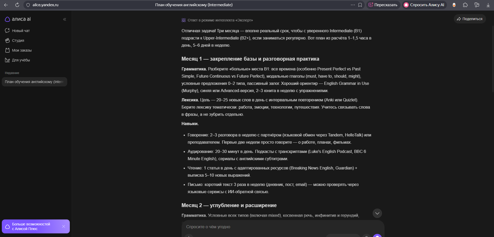
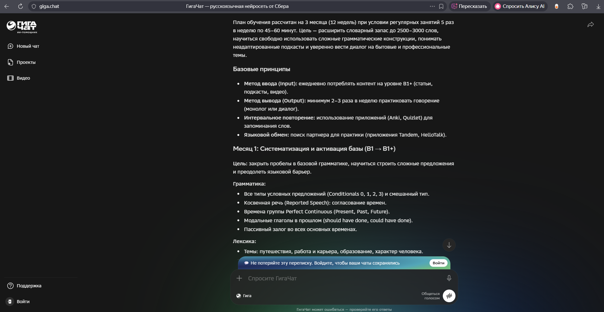
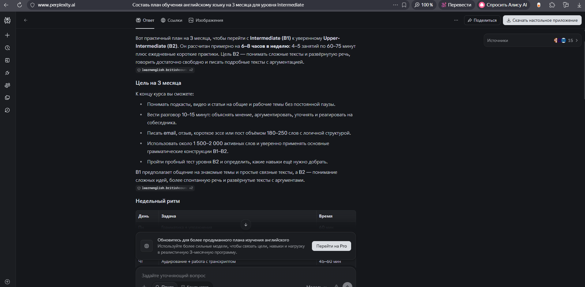

## easy

1.

Персонаж А
Ошибка: путает генерацию с поиском — LLM не «находит» информацию, а предсказывает вероятный текст; запрос без контекста даёт усреднённый результат.
Правильное понимание: промпт — это постановка задачи. Чем точнее заданы роль, аудитория, формат и ограничения, тем полезнее ответ. Промпт-инжиниринг — необходимый навык, а не формальность.

Персонаж Б
Ошибка: принимает убедительность за достоверность — это риск галлюцинаций (выдуманные цифры, тикеры, даты). Финансы — зона обязательной проверки.
Правильное понимание: уверенный тон не гарантирует правды. Факты и цифры проверяются по независимым источникам; в решениях с высокой ценой ошибки ИИ — черновик, финальное решение за человеком.

Персонаж В
Ошибка: преждевременная автоматизация — сразу API и «всё автоматизировать», хотя курс прямо говорит: к API переходят после того, как процесс освоен вручную через веб-интерфейс.
Правильное понимание: сначала пилот на веб-интерфейсе (проверить ценность, отладить промпты), API — когда задача регулярно повторяется и ручной процесс уже отлажен.

2.

| Категория | Запрос | Обоснование |
|---|---|---|
| **Низкий** | 1 | Пост для соцсетей на основе своего же примера. Нет конфиденциальных данных, результат легко проверить глазами. Риск: стилистическое несоответствие — правится вручную. |
| **Низкий** | 5 | Генерация идей для названий. Творческая задача без персональных данных. Риск: банальность или случайное совпадение с чужим брендом — нужна беглая проверка на уникальность. |
| **Средний** | 2 | Перевод прайс-листа с ценами. Риск: ошибка в цифрах/терминах при переводе, а также коммерческая чувствительность цен. Проверить перевод носителем/специалистом, не загружать лишние внутренние данные. |
| **Средний** | 7 | Психологический портрет кандидата. Риск: персональные данные (резюме, LinkedIn, заметки) уходят в открытую модель + субъективные выводы ИИ могут повлиять на решение о найме. Нужны согласие, обезличивание и человеческая оценка. |
| **Высокий** | 3 | План лечения диабета по анализам. Медицина — зона, где ИИ может выдать опасные рекомендации (дозировки, лекарства). Персональные медицинские данные нельзя грузить в открытую модель. Только врач. |
| **Высокий** | 4 | Анализ конкурента + приложены внутренние расчёты компании. Риск утечки коммерческой тайны в открытый сервис. Плюс возможные галлюцинации в финансах. Только закрытый контур и проверка аналитиком. |
| **Высокий** | 6 | Ответ на отзыв с полным именем, телефоном и деталями заказа. Риск утечки персональных данных клиента в открытую модель. Обезличить или не использовать ИИ для персонализации. |

## middle

# Задание 1.

* Создание контента для соцсетей - Веб-интерфейс: GigaChat / YandexGPT. 30 постов/мес, нужен контроль стиля и креатива — человек редактирует каждый пост.
* Ответы на вопросы клиентов в чате - API: GigaChat / YandexGPT API + бот. 20–30 однотипных вопросов в день — ручной ввод съедает время, API автоматизирует поток.
* Генерация идей для новых товаров - Не автоматизируем.	Веб-интерфейс, раз в месяц. Разовая задача, ошибка в выборе товара дороже экономии времени

Посты (веб): раз в месяц ИИ генерирует контент-план (30 тем) и по 3–5 вариантов текста на тему. Владелец выбирает, редактирует, добавляет фото и цены, публикует. Раз в месяц — анализ охватов и корректировка тем.

Чат (API): клиент пишет в чат → ИИ определяет тему (наличие, доставка, оплата) → отвечает по актуальной базе знаний магазина. Сложные вопросы и жалобы — передача человеку. Цены и наличие ИИ не выдумывает, а берёт из каталога.

# Задание 2. Сравнение нейросетей — отчёт

## 1. Задача

**Запрос:** «Составь план обучения английскому языку на 3 месяца для уровня Intermediate».

---

## 2. Использованные модели

| Модель | Доступ |
|---|---|
| GigaChat | Веб-интерфейс |
| Алиса ИИ (YandexGPT) | Веб-интерфейс |
| Perplexity | Веб-интерфейс |

---

## 3. Сравнительная таблица

| Критерий | GigaChat | Алиса ИИ | Perplexity |
|---|---|---|---|
| **Структура** | Самая подробная: 3 месяца → цели → грамматика/лексика/практика + недельный график + ресурсы | Логичная: месяц → грамматика → лексика → навыки → контроль + «ловушки» | Чёткая: цель → недельный ритм → месяц → контрольные точки → ресурсы |
| **Глубина анализа** | Высокая: расписаны конкретные темы грамматики и лексики по месяцам | Высокая: объясняет, зачем каждый блок, есть раздел типичных ошибок | Высокая: привязан к CEFR (B1→B2), объясняет критерии уровня |
| **Количество деталей** | Максимум: конкретные учебники, приложения, примеры эссе, дни недели | Средне-высокое: конкретные ресурсы, но меньше цифр и примеров | Высокое: конкретные объёмы (слов, минут, слов в эссе), но меньше примеров |
| **Качество рекомендаций** | Практично, можно сразу брать; местами перегружено | Практично, реалистично по нагрузке, есть предупреждения о ловушках | Практично, хорошо структурировано под измеримый прогресс |
| **Стиль** | Нейтральный, местами «механический», много списков | Естественный, дружелюбный, ближе к человеку | Суховатый, деловой, с ссылками на источники |

---

## 4. Факт-чекинг

| Утверждение | Источник проверки | Результат |
|---|---|---|
| «B1 — общение на знакомые темы, B2 — понимание сложных идей и развёрнутых текстов» (Perplexity) | Cambridge / British Council, CEFR descriptors | Подтверждено |
| «English Grammar in Use (Murphy, синий) — уровень Intermediate» (GigaChat, Алиса) | Официальный сайт Cambridge University Press | Подтверждено (синий = Intermediate, красный = Essential, зелёный = Advanced) |
| «Anki использует интервальное повторение» (GigaChat, Алиса) | Официальный сайт Anki | Подтверждено |
| «Arzamas.Academy — есть курсы на английском» (GigaChat) | Сайт Arzamas | **Галлюцинация/неточность:** Arzamas — русскоязычный просветительский проект о культуре, истории и литературе. На сайте есть материалы об английской культуре и литературе, однако это не курсы для изучения английского языка. Утверждение о наличии курсов на английском не подтверждается. |

**Найденная ошибка:** GigaChat в списке платформ указал «Arzamas.Academy (есть курсы на английском)». При проверке: Arzamas — русскоязычный просветительский проект, англоязычных курсов нет. Это фактическая ошибка (галлюцинация).

---

## 5. Доработанный вариант решения

На основе плана Perplexity (как самого структурированного и измеримого), с исправлением и дополнением:

| Месяц | Цель | Грамматика | Лексика | Практика | Контрольная точка |
|---|---|---|---|---|---|
| **1** | Укрепить базу B1 | Present Perfect vs Past Simple, Present Perfect Continuous, Future Forms, модальные, Conditionals 0–2 | Работа, путешествия, технологии, здоровье; фразовые глаголы, коллокации | Аудирование 2–3 подкаста/нед, чтение статей, монолог 5 мин/день, 1 email + 1 текст 120–150 слов/нед | Запись 3-мин монолога «My typical week and future plans» + список 10 повторяющихся ошибок |
| **2** | Развить аргументацию | Past Perfect, пассив, reported speech, Conditionals 2–3, wish/if only, артикли и предлоги | Linking words (however, although, despite, whereas), выражения мнения | Аудирование: интервью/TED 15–25 мин; чтение статей с мнениями; говорение 2 мин на «Do you agree…?»; эссе 180–220 слов/нед | Эссе «Should social media be limited for teenagers?» + обратная связь |
| **3** | Выйти на B2 | Инверсия, cleft sentences, сложные условные, relative clauses, глагольные паттерны | Идиомы (умеренно), академическая/деловая лексика, синонимы, коллокации | Нативные подкасты без субтитров; длинные статьи; 2 разговора/нед по 30–45 мин; эссе 220–250 слов/нед | Пробный тест B2 First (Cambridge) |

**Исправление:** убрано упоминание «Arzamas.Academy» как ресурса для английского. Заменено на **BBC Learning English** и **British Council LearnEnglish** (подтверждённые ресурсы уровня B1–B2).

**Дополнение из Алисы:** добавлен раздел «Типичные ловушки» — грамматика без говорения не переходит в актив; лучше 30 минут ежедневно, чем 3 часа раз в неделю; лексика без контекста забывается.

---

## 6. Какой инструмент выбрал бы

**Perplexity** — для задач планирования с измеримым результатом.

**Почему:** лучшая структура, привязка к CEFR, конкретные измеримые критерии (слов в эссе, минут аудирования, % понимания), ссылки на источники (Cambridge, British Council). GigaChat — самый детальный, но перегружен и содержит фактическую ошибку. Алиса — самый «человечный» и полезный разделом о ловушках, но менее измеримый.

# 3.

## Анализ разговоров:
Риск 1 
— конфиденциальность: Аудиозаписи содержат персональные данные клиентов и сотрудников. Нельзя отправлять такую информацию в открытые модели.
— Контроль: Использовать локальные или корпоративные модели с шифрованием; анонимизировать записи перед обработкой.

Риск 2 
— галлюцинации и неправильная интерпретация: Нейросеть может неверно понять контекст разговора и дать ошибочные рекомендации по качеству обслуживания, звучав уверенно.
— Контроль: Все выводы ИИ должны проверяться менеджером перед использованием; не доверять оценке ИИ полностью.

---

## Составление графика:
Риск 1 
— конфиденциальность: Персональные данные о предпочтениях сотрудников (выходные, медицинские ограничения) относятся к конфиденциальным.
— Контроль: Использовать локальное решение; ограничить доступ к данным; не передавать в открытые сервисы.

Риск 2 
— галлюцинации и логические ошибки: Нейросеть может создать нереальный график (нарушить трудовое законодательство, создать пересечения смен), не зная точных правил.
— Контроль: Вручную проверить каждый график перед внедрением; добавить валидацию по законам о труде.

---

Выбор: Инициатива Б.

Оба варианта содержат риски, но Инициатива Б менее опасна, так как её результаты проще проверить (логика графика явная), а данные более структурированы. Инициатива А связана с оценкой людей на
основе ИИ, что согласно материалу курса несёт этический риск и требует безусловной проверки человеком. При этом оба решения должны использовать только локальные модели из-за конфиденциальности данных.
